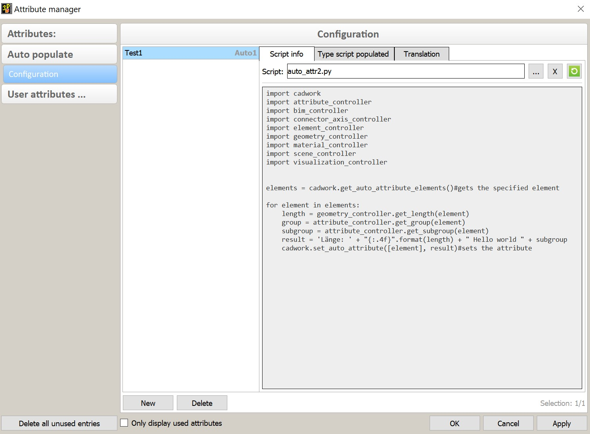
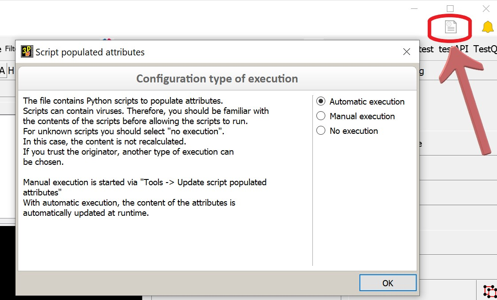

# Auto Attributes (script-filled attributes)

## What they are

Every element in cadwork carries attributes: name, group, subgroup, material, building, storey,
user attributes and many more. You use them to describe the parts, to structure the project and
to pass information to downstream systems such as an ERP.

Often the value of an attribute **depends on other data**, for example "group + length" or
"standard or special cross-section". Keeping such values up to date by hand is tedious and error
prone. **Script-filled attributes** solve this: you write a short Python script, and cadwork runs it
to **calculate the attribute value automatically**.

A script-filled attribute behaves like any other attribute. It appears in Modify, the info window
and plan outputs. You can use it to activate, show and hide elements, to compare and sort in list
calculations, and it is exported to lists. The only difference is that a script, not the user,
sets its content.

## Create a script-filled attribute

1. Write the Python script (see [Examples](#examples)) and save it as a `.py` file.
2. Open the **Attribute manager** (**Userprofile → Wood... → Attributes**).
3. Go to **Auto populate → Configuration**, click **New** and give the attribute a name.
4. On the **Script info** tab, click **...** and select your script. The dialog shows the script
   so you can check it.

<figure markdown="1">
{: style="width:700px"}
</figure>

### Limit it to element types

By default a script-filled attribute is calculated for **every element type**. On the
**Type script populated** tab you can restrict it, for example to beams only, when panels need
different logic or no value at all. Elements of other types keep an empty value. If you change an
element's type later, cadwork recalculates the attribute.

### Execution status

The icon to the left of the message center in the Windows menu bar shows whether script-filled
attributes are calculated automatically. Click it to change the status, for example to pause
calculations while you edit a large model.

<figure markdown="1">
{: style="width:700px"}
</figure>

## How the script works

cadwork runs your script whenever the attribute has to be recalculated. Two functions in the
`cadwork` module connect the script with cadwork:

- `cadwork.get_auto_attribute_elements()` returns the IDs of the
  elements that need a value in this run.
- `cadwork.set_auto_attribute(element_ids, value)` stores the text
  value for those elements.

Every script follows the same pattern:

```python
import cadwork
import attribute_controller as ac

for element_id in cadwork.get_auto_attribute_elements():
    value = ac.get_name(element_id).upper()  # calculate the value
    cadwork.set_auto_attribute([element_id], value)  # store it
```

Keep in mind:

- **The value is text.** Convert numbers with `str()` or an f-string, and round them first.
- **Every element needs a value.** Elements that don't receive one end up with an empty
  attribute.
- **If the script fails, nothing is written.** One error stops the update for all elements of
  that run.
- **Only read, don't change.** Use the script to read attributes and geometry. Don't create,
  modify or delete elements, and don't open dialogs. The script runs automatically and often.
- **Keep it fast.** The script runs for many elements and again after every relevant change.
  Avoid file access or network calls in the loop.
- **Units are millimetres**, like everywhere in the API.

## Examples

### Group and length

Combine the group with the length, rounded to whole millimetres.

```python title="group_length.py"
import cadwork
import attribute_controller as ac
import geometry_controller as gc

for element_id in cadwork.get_auto_attribute_elements():
    group = ac.get_group(element_id)
    length = round(gc.get_length(element_id))
    cadwork.set_auto_attribute([element_id], f'Group: {group} Length: {length}')
```

### Standard or special cross-section

Check whether width and height are multiples of 20 mm.

```python title="dimension_check.py"
import cadwork
import geometry_controller as gc

for element_id in cadwork.get_auto_attribute_elements():
    width = round(gc.get_width(element_id))
    height = round(gc.get_height(element_id))
    if width % 20 == 0 and height % 20 == 0:
        cadwork.set_auto_attribute([element_id], 'Standard cross-section')
    else:
        cadwork.set_auto_attribute([element_id], 'Special cross-section')
```

### Name, material and rounded dimensions

Combine name and material with width and height, rounded to the nearest 10 mm.

```python title="attributes_dimension.py"
import cadwork
import attribute_controller as ac
import geometry_controller as gc

for element_id in cadwork.get_auto_attribute_elements():
    name = ac.get_name(element_id)
    material = ac.get_element_material_name(element_id)
    width = int(round(gc.get_width(element_id), -1))
    height = int(round(gc.get_height(element_id), -1))
    cadwork.set_auto_attribute([element_id], f'{name};{material};{width};{height}')
```

### Material and storey

Combine the material with the building storey.

```python title="material_storey.py"
import cadwork
import attribute_controller as ac
import bim_controller as bc

for element_id in cadwork.get_auto_attribute_elements():
    storey = bc.get_storey(element_id)
    material = ac.get_element_material_name(element_id)
    cadwork.set_auto_attribute([element_id], f'{material} - {storey}')
```

## Debugging script-filled attributes

A script-filled attribute script runs in the background, so errors are easy to miss.

1. **Develop it as a normal plugin first.** Write the calculation as a function, test it on
   selected elements from the plugin bar or the Python console, and only then switch to
   `get_auto_attribute_elements()`:

    ```python
    import element_controller as ec
    import attribute_controller as ac
    import geometry_controller as gc


    def calculate(element_id):
        return f'Group: {ac.get_group(element_id)} Length: {round(gc.get_length(element_id))}'


    for element_id in ec.get_active_identifiable_element_ids():
        print(element_id, calculate(element_id))
    ```

2. **Turn on the console** to see tracebacks when the script runs, see
   [Debugging → Enable the cadwork console](debug.md#enable-the-cadwork-console).
3. **Log to a file** if the console isn't enough, see
   [Debugging → Log to a file](debug.md#log-to-a-file).
4. **Empty values everywhere?** The script probably failed (nothing is written then), or the
   element type is excluded on the **Type script populated** tab.

## Video

[Script-filled attributes video](videos.md#auto-attributes) (German).
