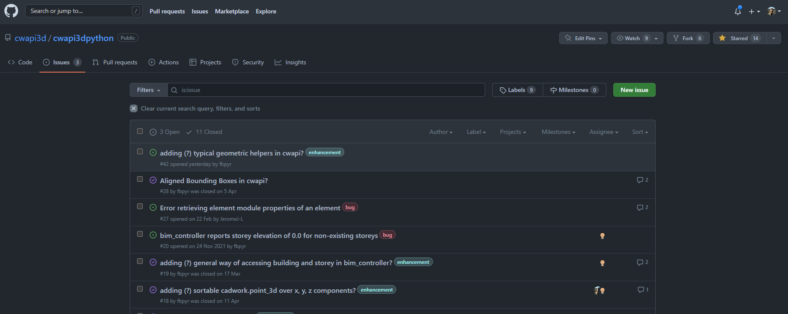

---
hide:
  - toc
---

# Community

Questions, bug reports and ideas are all welcome on GitHub. Posts are public, so every answer
helps the whole cadwork Python community. :rocket:

## Where to post what

| You want to ... | Go to |
| --------------- | ----- |
| ask how to do something, share a script, discuss an idea | [GitHub Discussions](https://github.com/cwapi3d/cwapi3dpython/discussions){target=_blank} |
| report a bug in the API or a wrong or missing piece of documentation | [GitHub Issues](https://github.com/cwapi3d/cwapi3dpython/issues){target=_blank} |
| request a new API function | [GitHub Issues](https://github.com/cwapi3d/cwapi3dpython/issues){target=_blank} |
| report a problem with cadwork itself (not the Python API) | your local cadwork support |

<figure markdown="1">

</figure>

## How to get a fast answer

Include these details. Most questions can then be answered on the first reply:

- **cadwork version and build:** **Help → Info**, or `utility_controller.get_3d_version_name()`
  and `utility_controller.get_3d_build()`.
- **`cwapi3d` version** if the question is about the stubs or your editor: `pip show cwapi3d`.
- **A minimal script** that shows the problem: as short as possible, runnable as a plugin.
- **The full error message** from the [cadwork console](debug.md#enable-the-cadwork-console)
  (copy the text, not a screenshot).
- **What you expected** and **what happened instead.**
- If the model matters: a small `.3d` file or a description of the selected elements.

!!! warning
    Posts are public. Remove customer names, project data and licence numbers before you post.

## Contribute to this documentation

Found a typo, an outdated screenshot or a missing explanation? This documentation lives in the
[cwapi3dpython repository](https://github.com/cwapi3d/cwapi3dpython){target=_blank}. Open an
issue, or a pull request that changes the Markdown files in `docs/`.

## Open source: cwmath

From the community, for the community: [cwmath](https://github.com/cwapi3d/cwmath){target=_blank}
is an open-source package of mathematical helpers (vectors, planes, transformations, ...) for
cadwork scripting. Use it in your plugins and help it grow with your own functions.
