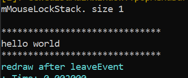
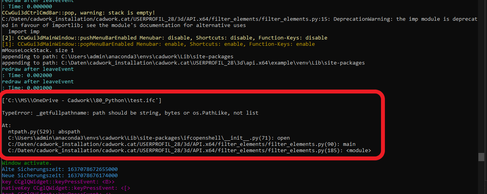
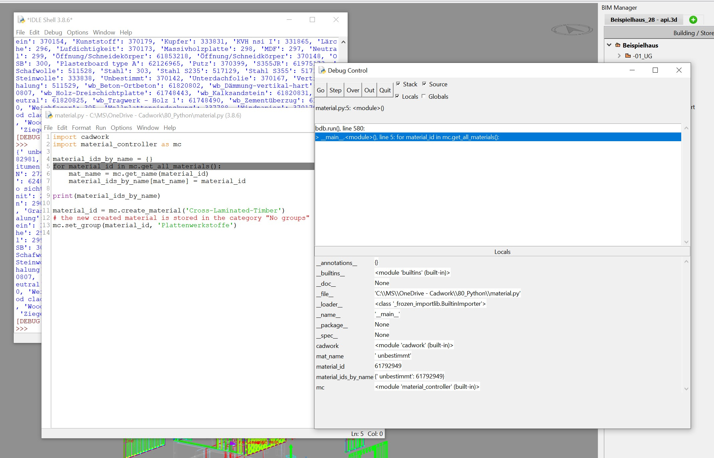

# Debugging

When a plugin does nothing, stops halfway or gives the wrong result, the first step is to **see
what Python is saying**. This page starts with the simple tools (console, messages, log files)
and ends with step-by-step debugging from PyCharm or VS Code.

## Quick checklist

1. **Is the console turned on?** Without it, error messages are invisible.
   See [Enable the cadwork console](#enable-the-cadwork-console).
2. **Did the plugin start at all?** Put `print('MyPlugin started')` on the first line.
3. **Is anything selected?** Many plugins work on `get_active_identifiable_element_ids()`, which
   returns an empty list if nothing is selected.
4. **Read the last lines of the traceback.** They name the file, the line and the error.
5. **Still unclear?** [Log to a file](#log-to-a-file) or [attach a debugger](#attach-a-debugger-from-your-ide).

## Enable the cadwork console

The cadwork console shows everything your plugin writes with `print()` and every error message
(traceback). Turn it on once:

1. Open **User Test → Userprofile → Test Options...**
2. Enable **Console**.
3. Restart cadwork. The console window opens together with cadwork.

{width="900"}

Now `print()` output appears in the console:

```python
print('hello world')
```

<figure markdown="1">
{width=300}
</figure>

### Reading an error message

When a plugin fails, Python prints a **traceback**:

<figure markdown="1">
{width=800}
</figure>

Read it **from the bottom up**:

- The **last line** is the error type and message, for example
  `AttributeError: module 'attribute_controller' has no attribute 'get_nme'`.
- The line above shows the **file and line number** in your script where it happened.
- Lines further up show how the code got there (which function called which).

## Messages for the user

`print()` is meant for you as the developer. To tell **users** what happened, write to the command
bar at the bottom of the 3D window:

```python
import utility_controller as uc

uc.print_message('Export finished.', 1, 1)       # neutral message (text, row, column)
uc.print_error('Please select a beam first.')    # shown as an error
uc.print_to_console('Step 3 of 5 done')          # written to the cadwork API log only
```

`print_error()` does **not** stop the script. Use `return` or raise an exception afterwards if the
plugin can't continue.

## Catch errors at the top level

Wrap the main code in `try`/`except`, so that users see a clear message and you still get the full
traceback in the console:

```python title="MyPlugin.py"
import traceback

import element_controller as ec
import utility_controller as uc


def main():
    element_ids = ec.get_active_identifiable_element_ids()
    if not element_ids:
        uc.print_error('MyPlugin: nothing selected.')
        return
    ...  # your code


try:
    main()
except Exception as error:
    traceback.print_exc()                      # full traceback in the console
    uc.print_error(f'MyPlugin failed: {error}')  # short message for the user
```

## Log to a file

Sometimes there is no console: in [headless command-line runs](command_line.md#running-headless-no-gui),
in [auto-attribute scripts](auto_attributes.md) or on a colleague's machine. Then write a log file
next to the plugin with the standard `logging` module:

```python
import logging
from pathlib import Path

LOG_FILE = Path(__file__).resolve().parent / 'MyPlugin.log'

logging.basicConfig(
    filename=LOG_FILE,
    level=logging.DEBUG,
    format='%(asctime)s %(levelname)s %(message)s',
    force=True,  # cadwork keeps the interpreter alive between runs, so reconfigure every time
)
log = logging.getLogger('MyPlugin')

log.info('started')
try:
    ...  # your code
except Exception:
    log.exception('plugin failed')  # writes the full traceback to the log file
    raise
```

Ask users to send you the `.log` file when something goes wrong.

## Debug with the Python console

The [Python console](get_started.md#choose-an-editor) (IDLE) has a built-in debugger: open the
**Debug** menu in the shell window, enable **Debugger**, then run your script with ++f5++. You can
step through the code line by line and look at the values of all variables.

<figure markdown="1">
{width=700}
</figure>

## Attach a debugger from your IDE

For larger plugins it is more comfortable to set breakpoints in PyCharm or VS Code. Because the
plugin runs **inside cadwork**, not in the IDE, you start the plugin in cadwork as usual and
**attach** the IDE debugger to it over a network port on your own machine.

!!! note "The debugger package must be importable inside cadwork"
    The debugger client (`debugpy` for VS Code, `pydevd-pycharm` for PyCharm) runs in cadwork's
    interpreter. Install it into a folder and put that folder on `sys.path`, exactly like any
    other [third-party package](modules.md#third-party-packages). Remove the debug code before
    you hand the plugin to others.

??? example "VS Code (debugpy)"

    1. Install the **Python Debugger** extension in VS Code.
    2. Install `debugpy` into a folder that your plugin adds to `sys.path`:

        ```bash
        py -3.14 -m pip install --target "C:\...\API.x64\MyPlugin\lib" debugpy
        ```

    3. Add this to the top of your plugin:

        ```python
        import sys
        from pathlib import Path

        sys.path.insert(0, str(Path(__file__).resolve().parent / 'lib'))

        import debugpy

        # cadwork's sys.executable is the cadwork program, not python.exe.
        # debugpy needs a real Python 3.14 to start its helper process.
        debugpy.configure(python=r'C:\Path\To\Python314\python.exe')
        if not debugpy.is_client_connected():
            debugpy.listen(('127.0.0.1', 5678))
            print('Waiting for VS Code to attach on port 5678 ...')
            debugpy.wait_for_client()
        debugpy.breakpoint()  # stops here once VS Code is attached
        ```

    4. Add an attach configuration to `.vscode/launch.json` in your plugin folder:

        ```json
        {
          "version": "0.2.0",
          "configurations": [
            {
              "name": "Attach to cadwork",
              "type": "debugpy",
              "request": "attach",
              "connect": { "host": "127.0.0.1", "port": 5678 },
              "justMyCode": true
            }
          ]
        }
        ```

    5. Click the plugin in cadwork. cadwork waits (it looks frozen, that's expected).
       In VS Code, start **Attach to cadwork**. Execution stops at `debugpy.breakpoint()` and at
       every breakpoint you set.

??? example "PyCharm Professional (pydevd-pycharm)"

    Remote debugging needs **PyCharm Professional**. See also the
    [JetBrains guide](https://www.jetbrains.com/help/pycharm/remote-debugging-with-product.html#remote-debug-config){target=_blank}.

    1. In PyCharm, create a **Python Debug Server** run configuration with host `localhost` and
       port `12345`. PyCharm shows the exact `pip install` command for your IDE version.
    2. Install the matching client into your plugin's `lib` folder:

        ```bash
        py -3.14 -m pip install --target "C:\...\API.x64\MyPlugin\lib" "pydevd-pycharm~=<your PyCharm build>"
        ```

    3. Start the **Python Debug Server** configuration in PyCharm (it starts listening).
    4. Add this to the top of your plugin and click it in cadwork:

        ```python
        import sys
        from pathlib import Path

        sys.path.insert(0, str(Path(__file__).resolve().parent / 'lib'))

        import pydevd_pycharm

        pydevd_pycharm.settrace('localhost', port=12345, stdoutToServer=True, stderrToServer=True, suspend=True)

        import element_controller as ec
        import attribute_controller as ac

        for element_id in ec.get_active_identifiable_element_ids():
            name = ac.get_name(element_id)  # set a breakpoint here
            print(element_id, name)
        ```

    PyCharm stops on the `settrace` line. From there you can step through and inspect variables.

## Common problems

| Problem | Cause and fix |
| ------- | ------------- |
| Plugin does nothing, no message | Console is off, so the error is hidden. [Turn it on](#enable-the-cadwork-console). |
| Nothing happens for selected elements | Nothing was actually selected, or hidden elements were selected. Check the list returned by `get_active_identifiable_element_ids()`. |
| Values are 1000 times too big or too small | The API works in **millimetres**. Convert when you read or write metres. |
| cadwork freezes | The script waits for input (`input()`, a debugger waiting for a client, an endless loop). Never use `input()`, use the dialog functions in `utility_controller` instead. |
| Changes to an imported helper module are ignored | Imported modules stay cached for the cadwork session. Restart cadwork or use `importlib.reload()`. |
| `AttributeError: module '...' has no attribute '...'` | Typo, or the function doesn't exist in your cadwork version. Compare with the [Reference](documentation/element_controller.md) and the [release notes](release_notes.md). |

Didn't solve it? Ask in the
[GitHub Discussions](https://github.com/cwapi3d/cwapi3dpython/discussions){target=_blank}, see
[Community](community.md) for what to include.
