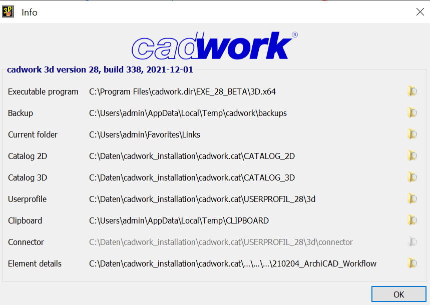
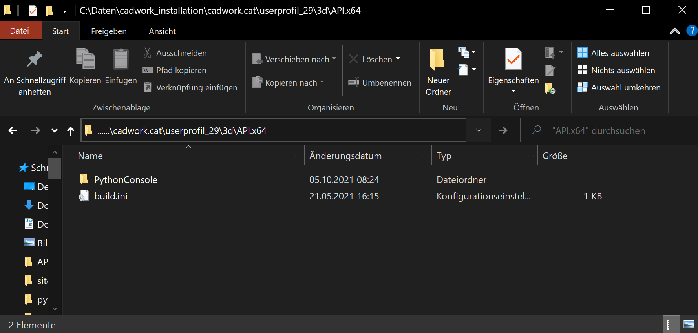
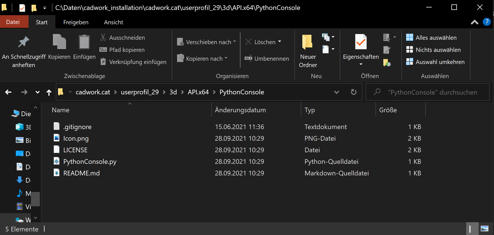
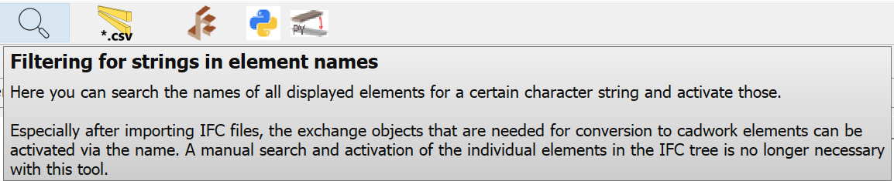
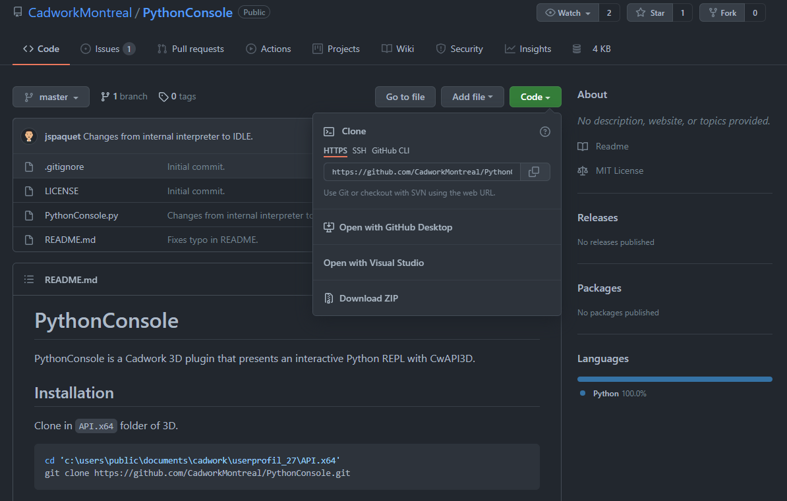
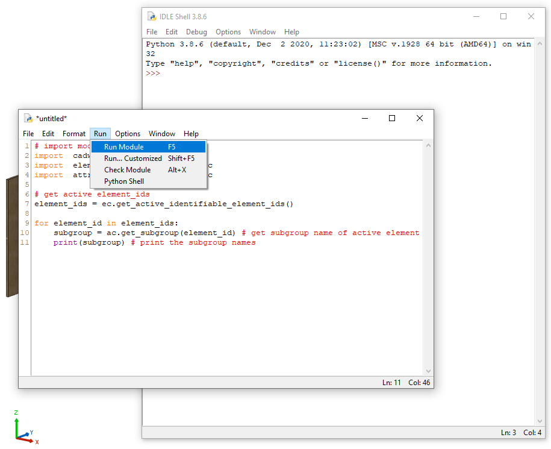

# Getting Started

This page takes you from a fresh cadwork installation to a working plugin on the plugin bar.
Beginners can follow the steps in order. Developers who already know Python can skip to
[Choose an editor](#choose-an-editor) and [Troubleshooting](#troubleshooting).

## Prerequisites

- cadwork 3D with a valid licence.
- Basic Python knowledge helps, see [New to Python?](index.md#new-to-python).

!!! info "Version facts"
    cadwork 3D **2026** ships its own **Python 3.14** interpreter (CPython, 64-bit). You do
    **not** need to install Python to run plugins inside cadwork.

    To check the version in your installation, run this in the Python console or a plugin:

    ```python
    import sys

    print(sys.version)
    ```

## 1. Find your `API.x64` folder

cadwork looks for Python plugins in the **`API.x64`** folder of your **userprofile**. The exact
path depends on your installation and version (for example
`D:\cadwork\USERPROFIL_2026\3d\API.x64`), so let cadwork show it to you:

1. Open any `.3d` file.
2. Click **Help → Info**.
3. Click **Userprofile**. Explorer opens your userprofile. The plugin folder is `3d\API.x64`
   inside it. If Explorer already shows the `3d` folder, open `API.x64` directly.

<figure markdown="1">
{width=600}
</figure>

??? note "Advanced: get the path from Python"
    ```python
    import os
    import utility_controller as uc

    profile_3d = uc.get_3d_userprofil_path()  # e.g. D:\cadwork\USERPROFIL_2026\3d
    print(os.path.join(profile_3d, 'API.x64'))  # the plugin folder
    print(uc.get_plugin_path())  # path of the running plugin script
    ```

## 2. Create your first plugin

Every plugin is a **folder** in `API.x64` that contains a **Python file with exactly the same
name**:

```text
API.x64\
└── HelloCadwork\            ← plugin folder
    ├── HelloCadwork.py      ← must have the same name as the folder
    ├── Icon.png             ← optional, shown on the plugin bar
    └── plugin_info.xml      ← optional, tooltip text
```

!!! warning "The names must match exactly"
    If the folder is called `HelloCadwork`, the script must be `HelloCadwork.py`, with the same
    spelling and the same upper and lower case. A plugin whose names don't match does **not**
    appear on the plugin bar.

<figure markdown="1">
{width=600}
</figure>

Put this code into `HelloCadwork.py`:

```python title="HelloCadwork.py"
import element_controller as ec
import attribute_controller as ac
import utility_controller as uc

element_ids = ec.get_active_identifiable_element_ids()

if not element_ids:
    uc.print_error('HelloCadwork: please select at least one element first.')
else:
    for element_id in element_ids:
        print(element_id, ac.get_name(element_id))
    uc.print_message(f'HelloCadwork: {len(element_ids)} element(s) selected.', 1, 1)
```

`print()` writes to the cadwork console (see [Debugging](debug.md)). `print_message()` and
`print_error()` show text in the command bar at the bottom of the 3D window, where users see it.

<figure markdown="1">
{width=600}
</figure>

## 3. Run it from the plugin bar

1. Start cadwork 3D, or restart it if it was already running, and open a `.3d` file. cadwork reads
   the plugin folders at startup.
2. Show the plugin bar: **Window → Plugins**.
3. Select a few elements and click the **HelloCadwork** button.

The command bar shows how many elements are selected. Without an icon, the button shows the folder
name.

!!! tip "Nothing happens?"
    Turn on the cadwork console to see error messages, see
    [Debugging → Enable the cadwork console](debug.md#enable-the-cadwork-console). Most first-run
    problems are covered in [Troubleshooting](#troubleshooting) below.

## 4. Add an icon and a description

### Plugin icon

Put a file named **`Icon.png`** or **`Icon.svg`** into the plugin folder (next to
`HelloCadwork.py`). Use a square image of about **30 × 30 pixels**. cadwork shows it on the
plugin bar instead of the folder name.

### Tooltip: `plugin_info.xml`

To show a title, version and description when the mouse hovers over the plugin button, save a
file called **`plugin_info.xml`** in the plugin folder:

<figure markdown="1">
{width=500}
</figure>

```xml title="plugin_info.xml"
<?xml version="1.0" encoding="UTF-8"?>
<PluginInfo>
    <Version>1.0.0.0</Version>
    <Date>2026-01-15</Date>
    <Author>Your Name</Author>
    <Name>
        <Text language="English">Hello cadwork</Text>
        <Text language="German">Hallo cadwork</Text>
        <Text language="French">Bonjour cadwork</Text>
    </Name>
    <Description>
        <Text language="English"><![CDATA[Prints the names of the selected elements.]]></Text>
        <Text language="German"><![CDATA[Gibt die Namen der aktiven Elemente aus.]]></Text>
        <Text language="French"><![CDATA[Affiche les noms des éléments actifs.]]></Text>
    </Description>
</PluginInfo>
```

??? note "All supported languages"
    You can add a `<Text language="...">` entry for each of these languages. Leave out the ones
    you don't need: `German`, `English`, `French`, `Italian`, `Spanish`, `Czech`, `Finnish`,
    `Russian`, `Polish`, `Romanian`, `Norwegian`, `Chinese`, `Portuguese`, `Estonian`,
    `Japanese`.

## Choose an editor

You can write plugins in any text editor. Two setups work well:

=== "Python console (beginners)"

    The **Python console** is a version of Python IDLE that runs **inside cadwork**. You can try
    out code line by line, run scripts with ++f5++ and use the IDLE debugger. It is the quickest
    way to experiment.

    **Install it**

    1. Go to [github.com/cwapi3d/PythonConsole](https://github.com/cwapi3d/PythonConsole){target=_blank}.
    2. Click **Code → Download ZIP** (or clone the repository).
    3. Extract it into your `API.x64` folder. The ZIP extracts to `PythonConsole-main`: rename
       the folder to **`PythonConsole`**, so that you get `API.x64\PythonConsole\PythonConsole.py`.
    4. Restart cadwork. **PythonConsole** now appears on the plugin bar.

    <figure markdown="1">
    {width=800}
    </figure>

    **Run code**

    Open the console from the plugin bar, then open or write a script, save it and press ++f5++
    (or **Run → Run Module**). The output appears in the console window.

    <figure markdown="1">
    {width=800}
    </figure>

=== "PyCharm / VS Code (developers)"

    A full IDE gives you autocompletion, type checking and inline documentation for every
    cadwork function. Install the **`cwapi3d`** package to get them.

    1. Install **Python 3.14** (64-bit) from [python.org](https://www.python.org/downloads/){target=_blank}.
       This is only for the editor; cadwork still uses its own interpreter.
    2. Create a virtual environment for your plugin project and install the stubs:

        ```bash
        python -m venv .venv
        .venv\Scripts\activate
        pip install cwapi3d
        ```

        To match an older cadwork build, pin the version:
        `pip install cwapi3d==<version>`. The [release notes](release_notes.md) list what
        changed in each version.

    3. Open the plugin folder (or your whole `API.x64` folder) in the IDE and select the
       `.venv` interpreter.

    !!! warning "You cannot run plugins from the IDE"
        `cwapi3d` contains only **stubs** (signatures and documentation), no implementation.
        Running a script from PyCharm or VS Code ends with errors or does nothing. Always start
        the plugin **inside cadwork**: from the plugin bar, the Python console or the
        [command line](command_line.md). To step through code from your IDE, attach a debugger,
        see [Debugging → Attach a debugger](debug.md#attach-a-debugger-from-your-ide).

    Source: [github.com/cwapi3d/cwapi3dpython](https://github.com/cwapi3d/cwapi3dpython){target=_blank} ·
    [PyPI](https://pypi.org/project/cwapi3d/){target=_blank}

## Run plugins from the command line

You can start cadwork with a file and run a plugin automatically, for example to process a whole
folder of files. See [Command Line](command_line.md).

## Troubleshooting

| Symptom | Likely cause | Fix |
| ------- | ------------ | --- |
| The plugin button doesn't appear | Folder and `.py` names differ (spelling or case) | Rename so that `MyPlugin\MyPlugin.py` match exactly |
| | Plugin is in the wrong userprofile (several versions installed) | Open **Help → Info → Userprofile** in the cadwork version you use and check its `API.x64` |
| | cadwork was already running | Restart cadwork, plugins are read at startup |
| | Plugin bar is hidden | **Window → Plugins** |
| The button shows the name, not the icon | Icon file is misnamed or in the wrong place | Name it exactly `Icon.png` or `Icon.svg` and put it in the plugin folder |
| Clicking the button does nothing | The script raised an error you can't see | Turn on the [cadwork console](debug.md#enable-the-cadwork-console) and read the traceback |
| | Nothing was selected and the script quietly returns | Check `get_active_identifiable_element_ids()` and report empty selections with `print_error()` |
| `ModuleNotFoundError: No module named 'element_controller'` | The script was started outside cadwork (IDE, `python.exe`) | Run it from cadwork, the controllers exist only there |
| `ModuleNotFoundError` for a package such as `numpy` | Third-party packages are not installed for cadwork's Python | See [Packages and Modules](modules.md#third-party-packages) |
| Code works in the console but not as a plugin | Different working directory or relative paths | Build paths from the script location, see [Packages and Modules](modules.md#paths-relative-to-your-plugin) |

Still stuck? Ask in the
[GitHub Discussions](https://github.com/cwapi3d/cwapi3dpython/discussions){target=_blank} and
include your cadwork version, the script and the full error message.

## Next steps

- [Packages and Modules](modules.md): use the standard library and third-party packages.
- [Debugging](debug.md): console, logging and IDE debuggers.
- [Examples](examples/geometry.md): working code for every controller.
- [Videos](videos.md): watch a plugin being built from scratch.
