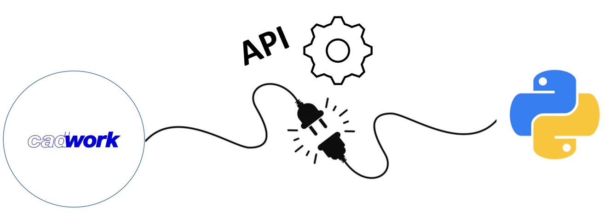

---
hide:
  - toc
---

# cadwork Python Documentation

cadwork 3D has a built-in Python interpreter and an API (the **cwapi3d** controllers). With it you
can automate and extend cadwork without changing the program itself. This guide gets you from
"I have never scripted cadwork" to running, debugging and sharing your own plugins.

## What you can do with Python in cadwork

- **Model:** create, modify, move and cut elements (beams, panels, axes, connectors, ...).
- **Read and write data:** names, groups, materials, user attributes and geometry of any element.
- **Lists and exports:** generate production lists, export IFC, BTL, STEP, DXF and more.
- **Script-filled attributes:** let a script calculate attribute values automatically
  ([Auto Attributes](auto_attributes.md)).
- **Batch processing:** open many files from the command line, run a plugin on each and save or
  export the result ([Command Line](command_line.md)).
- **Your own tools:** small helpers on the plugin bar, up to full applications with their own UI.

## Where to start

| I want to ...                                         | Go to                                          |
| ----------------------------------------------------- | ---------------------------------------------- |
| set up cadwork and run my first plugin                | [Getting Started](get_started.md)              |
| use standard or third-party Python packages           | [Packages and Modules](modules.md)             |
| find out why my plugin does nothing or crashes        | [Debugging](debug.md)                          |
| run cadwork and plugins from a script or batch file   | [Command Line](command_line.md)                |
| look up a function                                    | [Reference](documentation/element_controller.md) |
| copy a working example                                | [Examples](examples/geometry.md)               |
| let an AI assistant answer API questions              | [MCP](mcp.md)                                  |
| ask a question or report a bug                        | [Community](community.md)                      |

## How it fits together

An application programming interface (API) is a defined way for one program to use another.
cadwork exposes its functions to Python as a set of **controller modules**, grouped by topic:

```python
import cadwork  # core types: point_3d, element_type, ...
import element_controller as ec  # create, select, modify elements
import attribute_controller as ac  # names, groups, materials, user attributes
import geometry_controller as gc  # lengths, axes, points, volumes
import utility_controller as uc  # messages, dialogs, paths, version info
```

These modules exist **only inside cadwork**. Your plugin always runs in cadwork's own Python
interpreter, started from the plugin bar, the Python console or the command line. The
[`cwapi3d` package on PyPI](https://pypi.org/project/cwapi3d/){target=_blank} provides the same
modules as type stubs, so your editor can offer autocompletion and documentation while you write
code.

<figure markdown="1">
{ width="500" }
</figure>

A first taste: print the subgroup of every selected element.

```python
import element_controller as ec
import attribute_controller as ac

for element_id in ec.get_active_identifiable_element_ids():
    print(ac.get_subgroup(element_id))
```

## New to Python?

Python is easy to read and quick to try out, which makes it a good fit for automating cadwork. If
you have never written Python before, work through a short tutorial first and then come back:

- [The official Python Tutorial](https://docs.python.org/3/tutorial/){target=_blank}
- [LearnPython](https://www.learnpython.org/){target=_blank}
- [Real Python](https://realpython.com/){target=_blank}

## Questions?

Ask in the [GitHub Discussions](https://github.com/cwapi3d/cwapi3dpython/discussions){target=_blank}.
The posts are public, so every answer helps the next person too.
