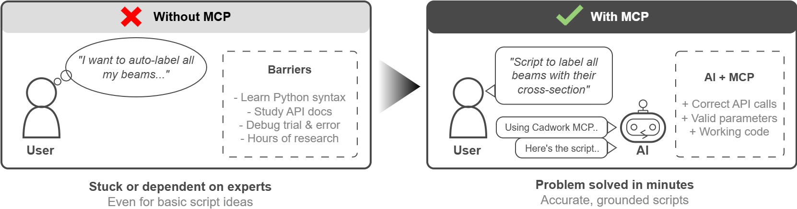
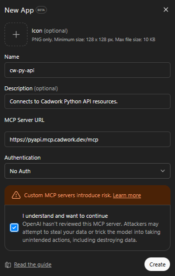

---
hide:
  - navigation
  - toc
---

# {: style="height: 32px; vertical-align: middle;" } MCP Cadwork Python API Server

**MCP URL:** `https://pyapi.mcp.cadwork.dev/mcp`

## What is MCP?

The **Model Context Protocol (MCP)** is an open standard that enables AI assistants to securely connect to external
context. Think of it as a bridge that allows AI models to access real-time, specialized information beyond their
training data.

When you connect an AI assistant to an MCP server, it gains the ability to query that server for relevant context,
making responses more accurate and up-to-date.

!!! info "What this server does and doesn't do"
    The cadwork Python API MCP server gives your assistant **read-only access to this
    documentation**: every controller, function signature, docstring and example. It does
    **not** connect to cadwork 3D and cannot change a model. You don't need cadwork installed
    to use it, and no account or API key is required.

{width="1200" style="display: block; margin: 0 auto;"}

## Demo

See how easy it is to use the Cadwork Python API with an MCP-enabled AI assistant:

<video controls autoplay loop muted playsinline width="900"
       style="display: block; margin: 0 auto;">
  <source src="../img/mcp/gemini-mcp.mp4" type="video/mp4">
</video>

You can use the Cadwork Python MCP for:

- **Contextual Answers**: Ask questions in natural language and get responses that reference the actual API
  documentation, including function signatures, parameters, and code examples.
- **Code Generation**: Request script snippets for specific tasks. The AI can generate code using the correct Cadwork
  API functions because it has direct access to the documentation.
- **Discovery**: Explore available modules and functions by simply asking "What functions are available for geometry
  operations?" or "How do I work with elements?"
- **Troubleshooting**: Describe an error or unexpected behavior, and get help that's grounded in the actual API
  specifications.

## Setup instructions

To use the Cadwork Python API documentation as an MCP server, you need to configure your AI assistant to connect to it.
Here are the most common AI assistants and how to configure them:

??? note "Claude Desktop"

    Add the following to your Claude Desktop configuration file via the UI:

    `Settings` > `Connectors` > `Add custom connectors`

    [Claude MCP Documentation](https://modelcontextprotocol.io/docs/develop/connect-remote-servers){target=_blank}

??? note "Claude Code (CLI)"

    Claude Code supports MCP servers natively. Add the server using:

    ```bash
    claude mcp add --transport http cadwork-pyapi https://pyapi.mcp.cadwork.dev/mcp
    ```

    [Claude Code MCP Guide](https://code.claude.com/docs/en/mcp){target=_blank}

??? note "ChatGPT"

    ChatGPT does support MCP servers connector (they are called App) but only on *developer mode*. You need to activate it
    first and then:

    `Settings` > `Apps` > `Create app` (Developer mode: on) > `Create app`

    <figure markdown="1">
    {width=300}
    </figure>

    [OpenAI Plugins Documentation](https://help.openai.com/en/articles/11487775-apps-in-chatgpt#building-your-own-app){target=_blank}

??? note "VS Code (GitHub Copilot)"

    Add the following to your VS Code settings file (`.vscode/mcp.json` in your workspace or user settings):

    ```json
    {
      "servers": {
        "cadwork-pyapi": {
          "type": "http",
          "url": "https://pyapi.mcp.cadwork.dev/mcp"
        }
      }
    }
    ```

    [VS Code MCP Documentation](https://code.visualstudio.com/docs/copilot/chat/mcp-servers){target=_blank}

??? note "Gemini CLI"

    Gemini CLI supports MCP servers natively through its command-line interface.

    **Prerequisites**: Install the Gemini CLI first:

    ```bash
    npm install -g @google/gemini-cli@latest
    ```

    **Add the server**:

    ```bash
    gemini mcp add --transport http cadwork-pyapi https://pyapi.mcp.cadwork.dev/mcp
    ```

    **Verify the connection**:

    ```bash
    gemini mcp list
    ```

    Once added, the Cadwork Python API documentation will be automatically available when you interact with Gemini CLI.

    [Gemini MCP Guide](https://geminicli.com/docs/tools/mcp-server){target=_blank}

## Verify it works

After adding the server, start a new chat and ask a question that only the documentation can
answer, for example:

> Using the cadwork Python API MCP server: which function returns the length of an element, and in
> which unit?

A working setup shows a call to the MCP server (most assistants display the tool name) and answers
with `geometry_controller.get_length()` in millimetres. If the assistant answers without calling
the server, mention the server by name in your question or check that it is enabled for the chat.

## Troubleshooting

| Problem | Fix |
| ------- | --- |
| The server doesn't appear in the assistant | Check the URL: `https://pyapi.mcp.cadwork.dev/mcp` (with `/mcp` at the end). Restart the assistant after changing its configuration. |
| Connection error or timeout | Open the URL in a browser. If it doesn't load, a company proxy or firewall may block it. Ask your IT to allow `pyapi.mcp.cadwork.dev`. |
| The assistant uses the server but invents functions | Ask it to check every function against the server, and verify the code against the [Reference](documentation/element_controller.md). |
| Generated code fails in cadwork | Run it inside cadwork, not in the IDE (see [Getting Started](get_started.md#troubleshooting)), and follow [Debugging](debug.md). |
